<p align="center">
  
</p>

<p align="center">
  <a href="https://github.com/kyameinsahilwho">
    
  </a>
</p>

<p align="center">
  <a href="https://sahilkumarsingh-com.vercel.app"></a>
  
  <a href="https://github.com/kyameinsahilwho?tab=followers"></a>
</p>

---

## 🛰️ Mission briefing

```ts
const sahil = {
  role: "Full-stack builder",
  stack: ["TypeScript", "React", "Next.js", "Astro", "Node.js", "Tailwind"],
  launchpad: "Vercel",
  currently: "shipping side projects at warp speed",
  copilot: "Pebble 🪨👨‍🚀",
};
```

## 🧰 Flight systems

<p align="center">
  
</p>

## 🚀 Recent launches

<table>
  <tr>
    <td width="50%" valign="top">
      <h3>📈 <a href="https://github.com/kyameinsahilwho/thestock.space">thestock.space</a></h3>
      
      <a href="https://thestock-space.vercel.app"></a>
    </td>
    <td width="50%" valign="top">
      <h3>🔭 <a href="https://github.com/kyameinsahilwho/stock-scan-universe">stock-scan-universe</a></h3>
      
    </td>
  </tr>
  <tr>
    <td width="50%" valign="top">
      <h3>🟩 <a href="https://github.com/kyameinsahilwho/habit-grid">habit-grid</a></h3>
      
      <a href="https://habit-grid-pearl.vercel.app"></a>
    </td>
    <td width="50%" valign="top">
      <h3>📦 <a href="https://github.com/kyameinsahilwho/gofiles">gofiles</a></h3>
      
      <a href="https://gofiles-bay.vercel.app"></a>
    </td>
  </tr>
  <tr>
    <td width="50%" valign="top">
      <h3>🔗 <a href="https://github.com/kyameinsahilwho/share-now">share-now</a></h3>
      
      <a href="https://share-now-pink.vercel.app"></a>
    </td>
    <td width="50%" valign="top">
      <h3>𝕏 <a href="https://github.com/kyameinsahilwho/x-tracker">x-tracker</a></h3>
      
      <a href="https://x-tracker-two.vercel.app"></a>
    </td>
  </tr>
</table>

## 📡 Telemetry

<p align="center">
  
  
</p>

<p align="center">
  
</p>

<p align="center">
  
</p>

## 🐍 Orbit log

<picture>
  <source media="(prefers-color-scheme: dark)" srcset="https://raw.githubusercontent.com/kyameinsahilwho/kyameinsahilwho/output/github-snake-dark.svg" />
  <source media="(prefers-color-scheme: light)" srcset="https://raw.githubusercontent.com/kyameinsahilwho/kyameinsahilwho/output/github-snake.svg" />
  
</picture>

---

<p align="center">
  
</p>
